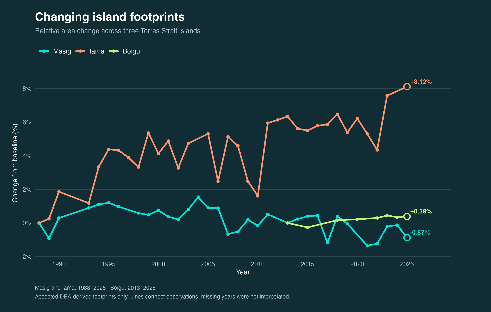
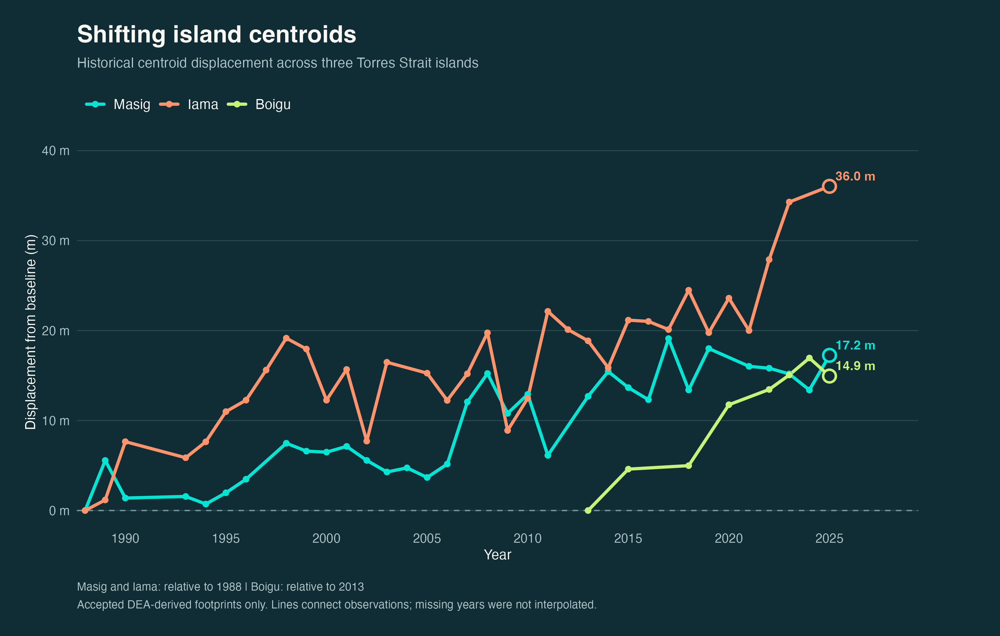
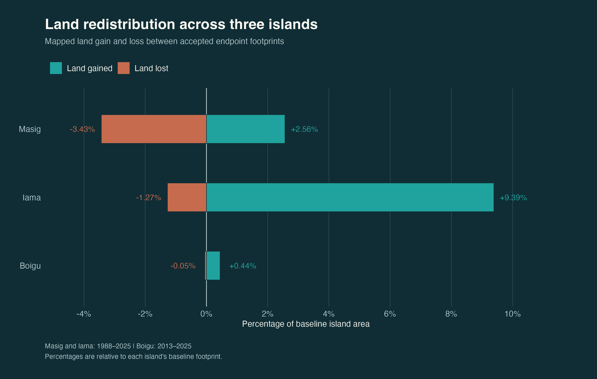
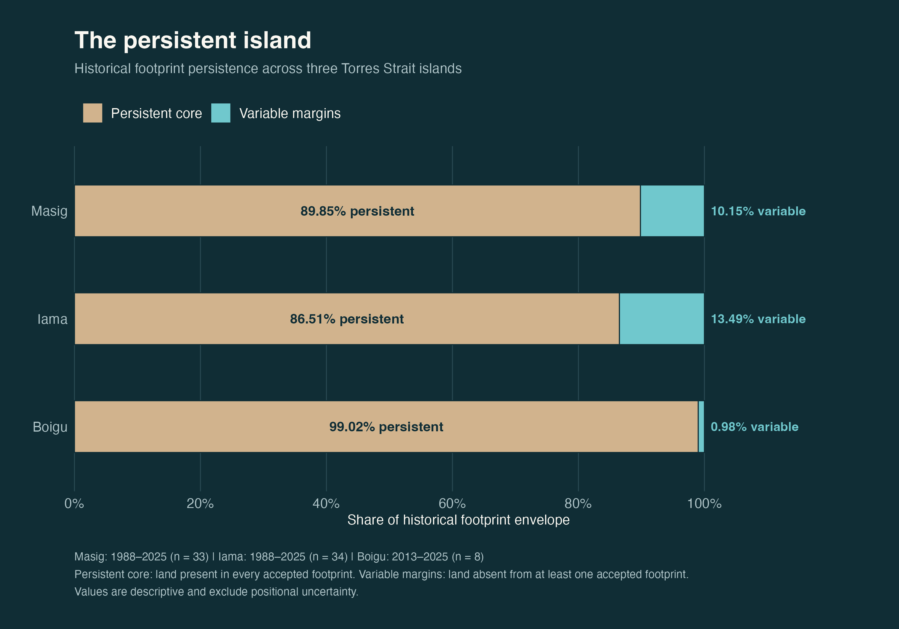
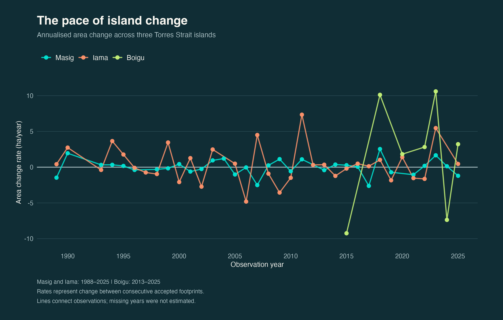

# Shifting Shorelines

### Coastal change across three Torres Strait islands

A reproducible analysis of historical coastal change across Masig, Iama and Boigu Islands in the Torres Strait, Australia.

This repository contains processed analytical datasets, independent R scripts and scientific figures developed to support the *Shifting Shorelines* ArcGIS StoryMap.

The project investigates changes in island extent, geometry, land redistribution, historical footprint persistence and elevation sensitivity.

## Study Islands

Three islands representing contrasting geomorphological settings were selected.

| Island | Island type | Study period | Accepted observations |
|---|---|---|---|
| Masig | Coral cay | 1988–2025 | 33 |
| Iama | Continental island | 1988–2025 | 34 |
| Boigu | Delta island | 2013–2025 | 8 |

Missing observations were excluded rather than interpolated.

The different observation periods are considered when interpreting comparisons between islands.

## Research Objectives

1. Quantify historical changes in reconstructed island area and geometry.
2. Examine centroid displacement relative to historical baseline positions.
3. Compare land gained and lost between accepted endpoint footprints.
4. Investigate historical footprint persistence and variable coastal margins.
5. Examine annualised rates of island area change.
6. Compare low-lying land and preliminary coastal connectivity across contrasting island environments.

## Repository Structure

```text
CoastlinesR/
├── CoastlinesR.Rproj
├── data/
│   └── processed/
├── scripts/
│   ├── 01_AnnualAreaChange_Comparison.R
│   ├── 02_CentroidDisplacement.R
│   ├── 03_LandRedistribution.R
│   ├── 04_FootprintPersistence.R
│   ├── 05_AnnualAreaChangeRates.R
│   └── 06_CoastalConnectivity_Statistics.R
├── figures/
│   ├── 01_AnnualAreaChange.png
│   ├── 02_CentroidDisplacement.png
│   ├── 03_LandRedistribution.png
│   ├── 04_FootprintPersistence.png
│   └── 05_AnnualAreaChangeRates.png
└── README.md
```

## Statistical Analyses

### 01. Historical Island Area Change

Examines changes in reconstructed island area relative to each island's baseline footprint.

Percentage change allows comparison between islands of substantially different sizes.



### 02. Centroid Displacement

Measures the distance between each accepted annual footprint centroid and its baseline centroid.

Baseline years:
- Masig: 1988
- Iama: 1988
- Boigu: 2013

Centroid displacement describes changes in the spatial distribution of island land, rather than shoreline retreat or cumulative centroid movement.



### 03. Endpoint Land Redistribution

Compares land gained and lost between accepted historical endpoint footprints.

- Masig: 1988–2025
- Iama: 1988–2025
- Boigu: 2013–2025

The analysis demonstrates why net island area change alone may conceal substantial spatial redistribution.



### 04. Historical Footprint Persistence

Examines the proportion of the historical island footprint envelope that remained present across accepted observations.

Persistent land is distinguished from more variable coastal margins.

Masig and Iama have documented multi-year persistence calculations.

Boigu's previously plotted 99.02% historical persistence value is retained in the working figure, but its original all-year calculation has not yet been recovered. It should not be cited as independently verified until its provenance is established.



### 05. Annualised Island Area Change Rates

Calculates changes in reconstructed island area between consecutive accepted observations.

Rates are expressed in hectares per year and account for unequal observation intervals.

Connecting lines are visual aids and do not imply continuous measurements between observations.



### 06. Coastal Connectivity Statistics

Provides descriptive statistics supporting the project's coastal-connectivity GIS maps.

The analysis compares the proportion of valid LiDAR-covered land at or below two hypothetical elevation thresholds:

- +1.0 m AHD
- +2.0 m AHD

Three categories are considered:

1. Coastal-contact low-lying land.
2. Low-lying land with unconfirmed coastal connectivity.
3. Land above the selected elevation threshold.

The script also calculates differences between thresholds and identifies the largest and smallest proportions across islands.

These results are exploratory elevation-screening statistics, not predicted flood extents.

No additional figure is generated because the spatial resultss.
- Centroid displacement statistics.
- Endpoint land redistribution summaries.
- Historical footprint persistence measurements.
- Three-island coastal-connectivity comparisons.

The repository contains processed analytical outputs rather than the complete source GIS datasets.

Original spatial processing was undertaken separately using ArcGIS Pro and ArcPy.

## Data Sources

### Digital Earth Australia Coastlines

Digital Earth Australia Coastlines v3.1.0 provides the historical shoreline observations used to reconstruct annual island footprints.

Annual shorelines were screened and quality-controlled before inclusion in the analyses.

### Queensland Government LiDAR

Island-specific 1 m LiDAR-derived elevation datasets were used for elevation and coastal-connectivity analyses.

| Island | LiDAR survey year |
|---|---|
| Masig | 2011 |
| Iama | 2010 |
| Boigu | 2009 |

Elevation screening uses the Australian Height Datum (AHD) reference reported in the source documentation.

## Interpretation and Limitations

The analyses describe reconstructed island morphology and exploratory coastal elevation sensitivity.

Important considerations include:

- Reconstructed shoreline positions contain spatial uncertainty.
- Missing annual observations were not interpolated.
- Study periods differ between islands.
- Net area change does not describe the complete spatial distribution of land gain and loss.
- Centroid displacement does not measure cumulative shoreline movement.
- Endpoint overlap and historical footprint persistence are different measurements.
- LiDAR datasets represent historical terrain conditions rather than contemporary elevation surveys.
- Missing elevation data are excluded from coastal-connectivity percentage calculations.
- Coastal-contact classifications use simplified spatial connectivity rules.
- Hypothetical elevation thresholds are not equivalent to sea-level-rise predictions or storm-tide return periods.

The results should not be interpreted as direct measurements of coastal hazard, infrastructure exposure or future island disappearance.

## Project Status

Statistical analyses 01–06 have been developed.

Figures 01–05 support the project's spatial analyses, while Script 06 provides descriptive statistics for the coastal-connectivity maps.

The project is currently focused on final StoryMap integration, interpretation and documentation.

